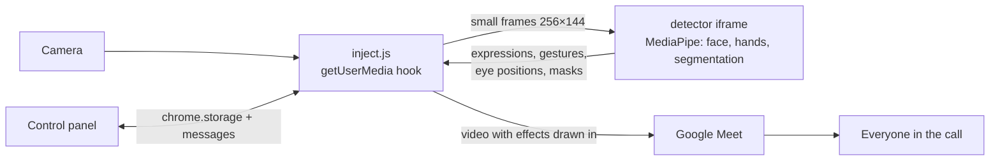

<p align="center">
  
</p>

<h1 align="center">Meme Cam for Google Meet</h1>

<p align="center">
  Make a face, show a gesture or clap twice, and the effect lands <b>in your camera video</b>.<br>
  Everyone in the call sees it. No virtual camera, no server, nothing leaves your computer.
</p>

<p align="center">
  <a href="README.ru.md">Читать по-русски</a> ·
  <a href="#install">Install</a> ·
  <a href="#how-to-use">How to use</a> ·
  <a href="docs/ARCHITECTURE.md">How it works</a>
</p>

<p align="center">
  
  
  
  
</p>


## Features

- **Memes from your face.** Open your mouth and eyes wide for *shock*, laugh for *LOL*, raise your eyebrows for *hmm*.
- **Memes from hand gestures.** 👍 👎 ✌️ ✊ 👋 ☝️ 🤟 each have their own meme.
- **Your own gestures.** Record any hand pose for a few seconds and attach a meme to it. Recognition is few-shot (k-nearest neighbours on 3D hand landmarks), right in the browser.
- **Your own pictures and GIFs.** Replace any emoji with an image or an animated GIF and set your own caption.
- **Vanish.** Clap twice and you crumble into pixel dust; clap again and you reassemble. The background behind you is restored from a clean plate.
- **Laser eyes.** Frown and beams shoot from your eyes. Turn your head to aim; sparks fly where the beams leave the frame.
- **Calibration.** Five 3-second steps tune expression thresholds to your face.
- **A proper control panel.** Turn every effect on or off, pick colours and particle size, watch live recognition meters. Light and dark themes.
- **Light on resources.** Recognition runs on small 256×144 frames with back-pressure, so your camera keeps its frame rate even when the Meet tab is in the background (20 of 20 fps in tests).

## Install

Meme Cam is not in the Chrome Web Store yet, so you load it in developer mode. It takes a minute.

1. Get the code: **Code → Download ZIP** and unzip it, or
   ```sh
   git clone https://github.com/Javharr/meet-meme-cam.git
   ```
   You can also download a ready zip from [Releases](../../releases).
2. Open `chrome://extensions` and switch on **Developer mode** (top right).
3. Click **Load unpacked** and choose the **`extension`** folder.
4. Open [meet.google.com](https://meet.google.com). If a Meet tab was already open, reload it.

Requirements: Chrome 111 or newer on macOS, Windows or Linux. Other Chromium browsers (Edge, Brave, Arc) should work but are not tested. The machine-learning models and libraries are already inside the repository.

## How to use

Click the Meme Cam icon in the toolbar while a Meet tab is open. The panel shows what is running (camera, AI, clap listener, background) and has five tabs.

### Triggers

| Effect | Trigger |
|---|---|
| 😱 Shock | open your mouth and eyes wide |
| 😂 LOL | big smile |
| 🤨 Hmm | raise your eyebrows |
| 👍 Like · 👎 Nope | thumb up · thumb down |
| ✌️ Peace · 🔥 Fire | V sign · fist |
| 👋 Hi · 💡 Idea · 🤟 Love | open palm · index finger up · 🤟 |
| Your gesture | whatever you recorded in the **Gestures** tab |
| Vanish / reappear | two claps (the microphone in Meet must be on) |
| Laser eyes | frown and hold; relax to stop |

Each meme stays on screen for about 2.5 seconds (a GIF plays one full loop, up to 6 seconds). The same meme won't fire twice within 3.5 seconds.

### Hotkeys

On a Mac, use **Control**, not Command.

| Keys | Action |
|---|---|
| `Ctrl+Shift+V` | vanish / reappear |
| `Ctrl+Shift+P` | capture a clean background (step out of the frame) |
| `Ctrl+Shift+L` | laser eyes for 3 seconds / switch off |
| `Ctrl+Shift+1` `2` `3` | shock, like, fire |
| `Ctrl+Shift+M` | mirror your own preview (others always see you unmirrored) |
| `Ctrl+Shift+A` | pause recognition |
| `Ctrl+Shift+H` | debug overlay (**visible to everyone** in the call) |
| `Ctrl+Shift+B` | brightness boost for dark rooms |

### Tips

- **Vanish works best with a clean background.** Step out of the frame for two seconds and Meme Cam captures it automatically, or press *Capture background*. Without it, the hole is filled in from what the camera has seen.
- **If an expression fires by accident or not at all, run calibration** (tab *More*). It takes 15 seconds.
- **For your own gestures, slowly rotate your wrist while recording**, so the gesture is recognized from any angle. 10 or more samples are recommended.
- **Turn off Meet's own background effects** (blur, replace) when you use vanish. They are applied on top of Meme Cam's video and fight with it.

## How it works



The content script runs in the page's own world at `document_start`, before any Meet code, and wraps `navigator.mediaDevices.getUserMedia`. Meet asks for the camera and gets a `MediaStreamTrackGenerator` track. Every camera frame is drawn onto an `OffscreenCanvas` together with the active effect and passed on, so effects are part of the video itself.

Recognition runs in a hidden iframe served from the extension's own origin. That is the only place where MediaPipe's WebAssembly can load: the isolated content-script world and Workers both failed, for reasons described in [docs/ARCHITECTURE.md](docs/ARCHITECTURE.md). The architecture document also covers the clap detector, the vanish effect, how laser beams are aimed, and the performance work.

## Privacy

- **All processing happens on your computer.** Video and audio never leave the browser, except as the normal Meet stream you are already sending.
- **The extension makes no network requests.** The models and the library ship inside it.
- **It only runs on `meet.google.com`.** It asks for two permissions: `storage` for settings and `unlimitedStorage` for your images and gestures, all kept in Chrome's local storage. There is no analytics and no tracking.

## Limitations

- **The panel is in Russian.** An English UI is on the roadmap. The extension name and description are localized.
- **Meme captions are in Russian by default** (ШОК, ЛАЙК…). You can change any caption in the panel.
- **Meme Cam is tied to how Google Meet works today.** It is tested in Chrome on macOS, and a Meet update could break it. If the camera behaves strangely, switch on *Old camera engine* in the *More* tab.
- **Expression thresholds differ a lot between faces and lighting**, so calibration matters. Laser-eye tuning has been tested on photos so far, not on many live faces.

## Project structure

```
extension/            the Chrome extension: load this folder
  manifest.json
  inject.js           getUserMedia hook, effects, clap detector (page world)
  detector.js         bridge between the page and the detector iframe
  detector.html       hidden iframe hosting MediaPipe
  detector.frame.js   face, hand and segmentation models, custom-gesture kNN
  settings.js         defaults and the meme catalogue
  popup.*             control panel
  quiet.js            filters MediaPipe console noise
  models/  vendor/    MediaPipe models and library (Apache 2.0)
  fonts/   icons/
docs/                 architecture, dev log, screenshots
scripts/              check.sh (sanity checks), pack.sh (release zip)
```

## Development

There is no build step. Edit the files in `extension/`, then click ↻ on the extension in `chrome://extensions` and reload the Meet tab.

```sh
sh scripts/check.sh   # JSON and JS syntax, manifest file references
sh scripts/pack.sh    # dist/meet-meme-cam-<version>.zip
```

CI runs the same checks on every push. Pushing a tag such as `v1.4.0` publishes a release with the zip attached.

For debugging, open the console on the Meet tab and look for `[meme-cam]` lines, or run `__memeDiag()`. `Ctrl+Shift+H` shows the overlay, but remember that the other participants see it too.

The story of how the project got here, including every dead end, is in the [development log](docs/devlog.ru.md) (in Russian).

## Credits

- [MediaPipe](https://ai.google.dev/edge/mediapipe) by Google: models and the Tasks Vision library
- Fonts: [Onest](https://fontsource.org/fonts/onest), [IBM Plex Mono](https://fontsource.org/fonts/ibm-plex-mono), [Unbounded](https://fontsource.org/fonts/unbounded)

## License

The code is released under the [MIT License](LICENSE). Bundled third-party files keep their own licenses (Apache 2.0, SIL OFL 1.1); see [THIRD_PARTY_NOTICES.md](THIRD_PARTY_NOTICES.md).

Google Meet is a trademark of Google LLC. This project is not affiliated with Google.
