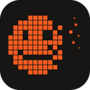
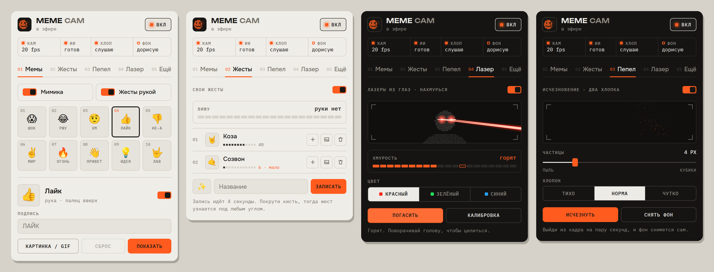
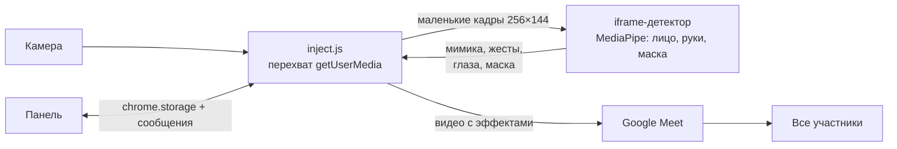

<p align="center">
  
</p>

<h1 align="center">Meme Cam для Google Meet</h1>

<p align="center">
  Скорчи рожу, покажи жест или хлопни дважды, и эффект появится <b>прямо в твоём видео</b>.<br>
  Его видят все участники звонка. Без виртуальной камеры и сервера, ничего не уходит с твоего компьютера.
</p>

<p align="center">
  <a href="README.md">English</a> ·
  <a href="#установка">Установка</a> ·
  <a href="#как-пользоваться">Как пользоваться</a> ·
  <a href="docs/ARCHITECTURE.md">Как устроено</a>
</p>



## Что умеет

- **Мемы от мимики.** Шок — открой рот и широко глаза, «ржу» — широкая улыбка, «хм» — подними брови.
- **Мемы от жестов рукой.** У 👍 👎 ✌️ ✊ 👋 ☝️ 🤟 свой мем у каждого.
- **Свои жесты.** Запиши любую позу кисти за несколько секунд и привяжи к ней мем. Распознавание few-shot (k ближайших соседей по 3D-точкам руки), прямо в браузере.
- **Свои картинки и GIF.** Любой эмодзи можно заменить картинкой или анимированным GIF, а подпись поставить свою.
- **Исчезновение.** Два хлопка — и ты рассыпаешься пиксельной пылью, ещё два — собираешься обратно. Фон за тобой восстанавливается.
- **Лазеры из глаз.** Нахмурься, и из глаз бьют лучи. Поворачивай голову, чтобы целиться; где лучи уходят за край кадра, летят искры.
- **Калибровка.** Пять шагов по 3 секунды подстраивают пороги мимики под твоё лицо.
- **Нормальная панель управления.** Включай и выключай каждый эффект, выбирай цвета и размер частиц, смотри живые индикаторы распознавания. Светлая и тёмная тема.
- **Бережёт ресурсы.** Распознавание идёт на маленьких кадрах 256×144 с обратной связью, поэтому камера держит частоту кадров даже в фоновой вкладке (20 из 20 кадров в секунду в тестах).

## Установка

В Chrome Web Store расширения пока нет, ставится в режиме разработчика. Это минута.

1. Скачай код: **Code → Download ZIP** и распакуй, или
   ```sh
   git clone https://github.com/Javharr/meet-meme-cam.git
   ```
   Готовый zip есть в [Releases](../../releases).
2. Открой `chrome://extensions` и включи **Режим разработчика** (справа сверху).
3. Нажми **Загрузить распакованное** и выбери папку **`extension`**.
4. Открой [meet.google.com](https://meet.google.com). Если вкладка Meet уже была открыта, обнови её.

Нужен Chrome 111 или новее на macOS, Windows или Linux. Другие браузеры на Chromium (Edge, Brave, Arc) должны работать, но не проверялись. Модели и библиотеки уже лежат в репозитории.

## Как пользоваться

Нажми на иконку Meme Cam на панели Chrome, пока открыта вкладка Meet. В панели видно, что работает (камера, ИИ, хлопки, фон), и пять вкладок.

### Что запускает эффекты

| Эффект | Как вызвать |
|---|---|
| 😱 Шок | открой рот и широко глаза |
| 😂 Ржу | широко улыбнись |
| 🤨 Хм | подними брови |
| 👍 Лайк · 👎 Не-а | большой палец вверх · вниз |
| ✌️ Мир · 🔥 Огонь | знак V · кулак |
| 👋 Привет · 💡 Идея · 🤟 Лав | открытая ладонь · указательный вверх · 🤟 |
| Свой жест | то, что записал во вкладке **Жесты** |
| Исчезнуть / появиться | два хлопка (микрофон в Meet должен быть включён) |
| Лазеры из глаз | нахмурься и держи, расслабишься — погаснут |

Мем висит около 2,5 секунды (GIF проигрывается целиком, но не дольше 6 секунд). Один и тот же мем не сработает повторно раньше чем через 3,5 секунды.

### Горячие клавиши

На Mac — **Control**, не Command.

| Клавиши | Что делают |
|---|---|
| `Ctrl+Shift+V` | исчезнуть / появиться |
| `Ctrl+Shift+P` | снять чистый фон (выйди из кадра) |
| `Ctrl+Shift+L` | лазеры на 3 секунды / погасить |
| `Ctrl+Shift+1` `2` `3` | шок, лайк, огонь |
| `Ctrl+Shift+M` | зеркало в твоём окне (собеседники всегда видят тебя без зеркала) |
| `Ctrl+Shift+A` | пауза распознавания |
| `Ctrl+Shift+H` | отладка поверх видео (**видят все** участники) |
| `Ctrl+Shift+B` | яркость для тёмной комнаты |

### Советы

- **Исчезновение лучше всего работает с чистым фоном.** Выйди из кадра на пару секунд, и Meme Cam снимет его сам, или нажми «Снять фон». Без него дыра дорисовывается по тому, что камера уже видела.
- **Если мимика срабатывает случайно или не срабатывает, пройди калибровку** (вкладка «Ещё»). Это 15 секунд.
- **Когда записываешь свой жест, медленно поворачивай кисть**, тогда он узнается под любым углом. Лучше 10 примеров и больше.
- **Для исчезновения выключи эффекты фона в самом Meet** (размытие, замену). Meet накладывает их поверх видео Meme Cam, и они мешают друг другу.

## Как устроено



Скрипт расширения запускается в мире самой страницы на `document_start`, раньше кода Meet, и подменяет `navigator.mediaDevices.getUserMedia`. Meet просит камеру, а получает трек `MediaStreamTrackGenerator`. Каждый кадр камеры рисуется на `OffscreenCanvas` вместе с активным эффектом и уходит дальше, поэтому эффект — часть самого видео.

Распознавание работает в скрытом iframe со страницей расширения. Только там загружается WebAssembly MediaPipe: в изолированном мире контент-скрипта и в Worker'е не вышло, подробности в [docs/ARCHITECTURE.md](docs/ARCHITECTURE.md). Там же — детектор хлопков, устройство исчезновения, как наводятся лазеры и что делалось ради скорости.

## Приватность

- **Всё обрабатывается на твоём компьютере.** Видео и звук никуда не уходят, кроме обычного потока Meet, который ты и так отправляешь.
- **Расширение не делает сетевых запросов.** Модели и библиотека лежат внутри него.
- **Работает только на `meet.google.com`.** Просит два разрешения: `storage` для настроек и `unlimitedStorage` для твоих картинок и жестов; всё хранится в локальном хранилище Chrome. Никакой аналитики и слежки.

## Ограничения

- **Панель пока только на русском.** Английский интерфейс в планах; название и описание расширения уже переведены.
- **Подписи мемов по умолчанию на русском** (ШОК, ЛАЙК…). Любую можно поменять в панели.
- **Meme Cam завязан на то, как Google Meet устроен сейчас.** Проверено в Chrome на macOS, и обновление Meet может что-то сломать. Если с камерой что-то не так, включи «Старый движок камеры» во вкладке «Ещё».
- **Пороги мимики сильно зависят от лица и света**, поэтому калибровка важна. Лазеры пока проверены на фотографиях, а не на многих живых лицах.

## Структура

```
extension/            само расширение: эту папку и загружаешь
  manifest.json
  inject.js           перехват камеры, эффекты, хлопки (мир страницы)
  detector.js         мост между страницей и iframe-детектором
  detector.html       скрытый iframe для MediaPipe
  detector.frame.js   модели лица, рук и маски, kNN своих жестов
  settings.js         настройки по умолчанию и каталог мемов
  popup.*             панель управления
  quiet.js            глушит служебный лог MediaPipe
  models/  vendor/    модели и библиотека MediaPipe (Apache 2.0)
  fonts/   icons/
docs/                 архитектура, журнал разработки, скриншоты
scripts/              check.sh (проверки), pack.sh (zip для релиза)
```

## Разработка

Сборки нет. Правишь файлы в `extension/`, нажимаешь ↻ у расширения в `chrome://extensions` и обновляешь вкладку Meet.

```sh
sh scripts/check.sh   # JSON, синтаксис JS, файлы из manifest.json
sh scripts/pack.sh    # dist/meet-meme-cam-<версия>.zip
```

На каждый push CI гоняет те же проверки. Тег вида `v1.4.0` публикует релиз с zip.

Для отладки открой консоль на вкладке Meet и ищи строки `[meme-cam]` или выполни `__memeDiag()`. `Ctrl+Shift+H` включает отладку поверх видео, но её видят и собеседники.

Как проект дошёл до этого, со всеми тупиками, — в [журнале разработки](docs/devlog.ru.md).

## Благодарности

- [MediaPipe](https://ai.google.dev/edge/mediapipe) от Google: модели и библиотека Tasks Vision
- Шрифты: [Onest](https://fontsource.org/fonts/onest), [IBM Plex Mono](https://fontsource.org/fonts/ibm-plex-mono), [Unbounded](https://fontsource.org/fonts/unbounded)

## Лицензия

Код распространяется по [лицензии MIT](LICENSE). Сторонние файлы внутри сохраняют свои лицензии (Apache 2.0, SIL OFL 1.1), см. [THIRD_PARTY_NOTICES.md](THIRD_PARTY_NOTICES.md).

Google Meet — товарный знак Google LLC. Проект не связан с Google.
